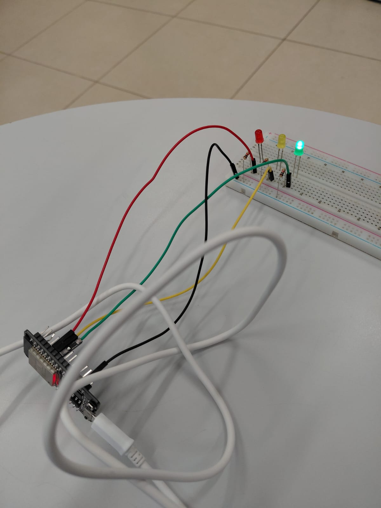
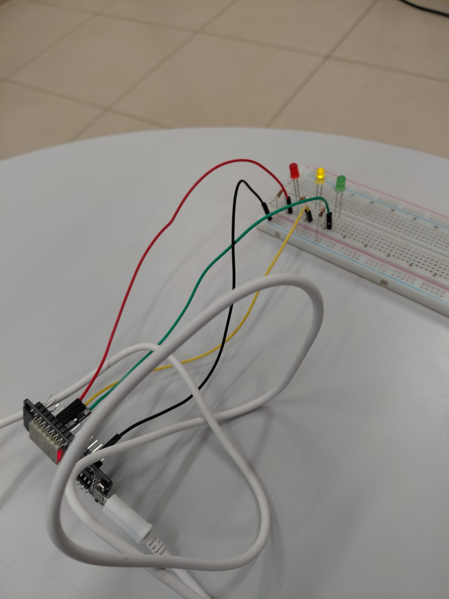
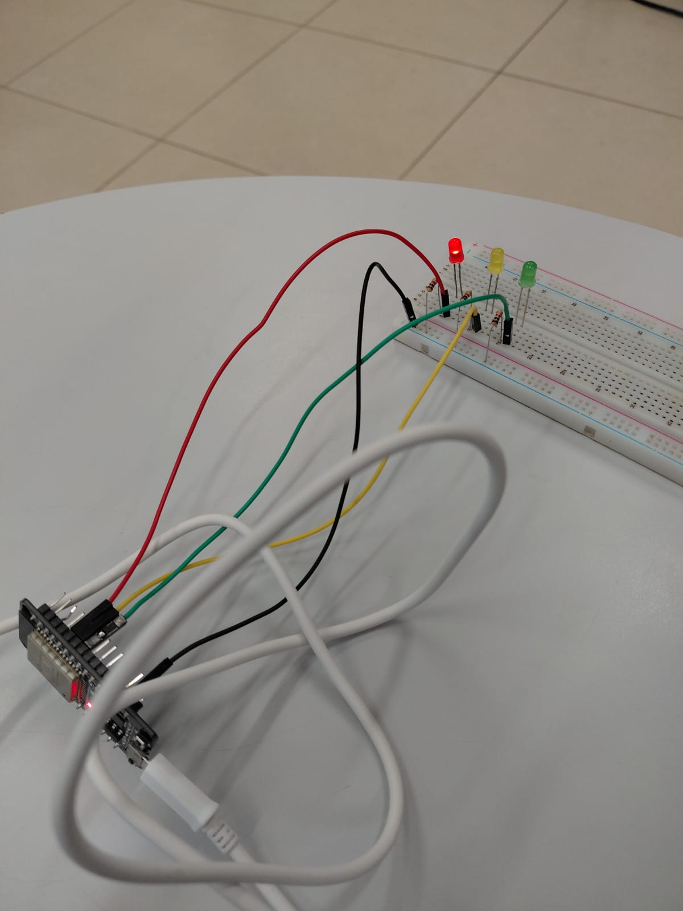

# 🚦 Experimento: Semáforo

## 📌 Sobre o projeto

Este projeto consiste na montagem e programação de um semáforo utilizando três LEDs de cores diferentes. O experimento foi realizado por **Isabelle Borges, Mirella Brolezi, Gabrielly Souza e Maria Eduarda Urbano**, com o objetivo de simular o funcionamento de um semáforo de trânsito.

## 🧰 Materiais utilizados

- 1 LED verde
- 1 LED amarelo
- 1 LED vermelho
- 3 resistores
- 1 microcontrolador ESP32
- 1 protoboard
- 4 jumpers macho-fêmea

## ⚙️ Como foi realizado

Primeiro, montamos o circuito na protoboard, conectando os três LEDs ao ESP32 com o auxílio dos resistores e dos jumpers. Em seguida, desenvolvemos a programação para controlar o acendimento das luzes, simulando a sequência de funcionamento de um semáforo de trânsito.

## 📸 Registro do experimento

Confira abaixo as fotos do nosso circuito montado e em funcionamento!

<table>
  <tr>
    <td align="center">
      <strong>🟢 Verde — Avance</strong> 
      
    </td>
    <td align="center">
      <strong>🟡 Amarelo — Atenção</strong> 
      
    </td>
    <td align="center">
      <strong>🔴 Vermelho — Pare</strong> 
      
    </td>
  </tr>
</table>

